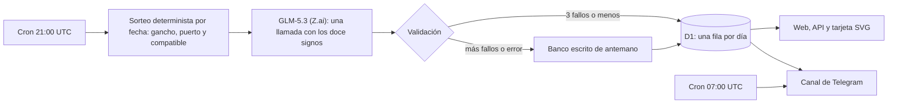

# Horóscopo de Bardo

[](https://github.com/Ogires/horoscopo-de-bardo/actions/workflows/ci.yml)

> *Tu signo es tu lenguaje. Y los astros no traen buenas noticias.*

Cada día, un bardo pesimista escribe el horóscopo de doce lenguajes de programación: Rust, JavaScript, Python, Java, C#, Go, PHP, COBOL, TypeScript, SQL, Kotlin y Haskell. Cada profecía trae su puerto de la suerte, el signo con el que eres compatible y lo que conviene evitar hoy. Se lee en la web, en una API pública, en una tarjeta para el README de tu perfil de GitHub y en un [canal de Telegram](https://t.me/horoscopodebardo).

**▶ Consulta los astros en <https://bardo.webninja.fyi>**

<p align="center">
  <a href="https://bardo.webninja.fyi/rust">
    <picture>
      <source media="(prefers-color-scheme: dark)" srcset="https://bardo.webninja.fyi/tarjeta/rust.svg?tema=oscuro">
      
    </picture>
  </a>
</p>
<p align="center"><sub>La tarjeta de hoy para Rust. Cambia cada día a medianoche (hora de Madrid).</sub></p>

## Ponlo en tu README

Copia este fragmento en el README de tu perfil y cambia `rust` por tu signo. Sigue el tema claro u oscuro que tengas en GitHub:

```html
<a href="https://bardo.webninja.fyi/rust">
  <picture>
    <source media="(prefers-color-scheme: dark)" srcset="https://bardo.webninja.fyi/tarjeta/rust.svg?tema=oscuro">
    
  </picture>
</a>
```

O en una línea de Markdown (sin `?tema`, la tarjeta sigue el modo del sistema operativo y no el de GitHub):

```markdown
[](https://bardo.webninja.fyi/rust)
```

Los signos son `rust`, `javascript`, `python`, `java`, `csharp`, `go`, `php`, `cobol`, `typescript`, `sql`, `kotlin` y `haskell`. La página de cada signo (por ejemplo, [/rust](https://bardo.webninja.fyi/rust)) tiene los dos fragmentos con un botón de copiar.

La tarjeta mide 495 px de ancho y su altura depende del texto, que se parte en líneas en el servidor. Usa fuentes del sistema, porque GitHub sirve las imágenes a través de su proxy (Camo) y un SVG no carga fuentes externas. Se sirve con `Cache-Control: no-cache` y un `ETag`, como recomienda GitHub para las imágenes que cambian: Camo revalida en cada visita y casi siempre recibe un 304.

## La API

Pública, sin clave y con CORS abierto. Devuelve JSON y lleva `ETag` en todas las respuestas.

| Ruta | Devuelve |
|---|---|
| `GET /api/v1/signos` | Los doce signos: slug, nombre, emoji y alias |
| `GET /api/v1/hoy` | Las doce profecías de hoy |
| `GET /api/v1/signos/{signo}` | La profecía de un signo hoy; con `?fecha=AAAA-MM-DD`, la de ese día |
| `GET /api/v1/dias/{fecha}` | Un día completo del archivo |

```bash
curl https://bardo.webninja.fyi/api/v1/hoy
curl -i https://bardo.webninja.fyi/api/v1/signos/rust   # mira la cabecera X-Bardo-Consejo
```

```json
{
  "fecha": "2026-12-01",
  "signo": "rust",
  "texto": "Un unwrap() que dejasteis «solo para probar» despertará en producción y entrará en pánico delante de todos. Nadie recordará que era temporal.",
  "puerto": { "numero": 6443, "servicio": "API de Kubernetes" },
  "compatible": { "signo": "php", "matiz": "que también sabe hacer die()" },
  "evita": "jurar que ese unwrap() es provisional",
  "origen": "banco"
}
```

- **`origen`** vale `ia` si la profecía la escribió el modelo y `banco` si sale del archivo escrito de antemano (ver [Cuando falla la IA](#cuando-falla-la-ia)).
- **El día es el de Madrid** y cambia a medianoche. Ninguna ruta enseña un día posterior a hoy ni anterior al lanzamiento.
- **Alias:** `js`, `ts`, `py`, `cs`, `rs`, `golang`, `kt`, `hs` y `c-sharp` redirigen con un 308 al slug.
- **Errores** en JSON y con la voz del Bardo: `{ "error": "signo_desconocido", "mensaje": "…" }`. 404 si el signo no existe o la fecha está fuera de rango, 400 si la fecha está mal escrita, 405 para lo que no sea `GET`, `HEAD` u `OPTIONS` y 429 si llegan demasiadas peticiones seguidas.
- **Caché:** hoy, hasta la medianoche de Madrid con un tope de una hora; los días pasados, un día.

La especificación completa está en [`/openapi.json`](https://bardo.webninja.fyi/openapi.json) (OpenAPI 3.1) y los ejemplos, en [`/api`](https://bardo.webninja.fyi/api/).

## Cómo funciona

**El cron escribe y todo lo demás solo lee.** Ninguna visita llama a la IA.



- **El código pone los hechos y la IA, la voz.** Antes de llamar al modelo, el código sortea para cada signo un **gancho**: un hecho cierto de su lenguaje («`NULL = NULL` no es verdadero: hay que usar `IS NULL`»), sacado de una lista de quince por signo que rotan en ciclos de quince días. También sortea el puerto de la suerte y el signo compatible. El modelo solo escribe el texto, el «Evita» y el matiz del compatible.
- **Una sola llamada al día** a GLM-5.3 con los doce signos, en modo JSON. Para que no se repita, recibe lo que escribió para cada signo los tres días anteriores.
- **Validación:** la forma del JSON, longitudes, palabras vetadas, nada de enlaces ni menciones, un «Evita» que no empiece por «no» y ningún texto que comparta seis palabras seguidas con lo publicado en los últimos catorce días, con el banco o con otro signo del mismo día.

Una sola expresión de cron, `0 21,22,7,8 * * *`, y el Worker decide qué toca según la hora:

| Hora UTC | En Madrid (invierno / verano) | Tarea |
|---|---|---|
| 21:00 | 22:00 / 23:00 | Generar el día que empieza a medianoche |
| 22:00 | 23:00 / 00:00 | Reintento: si el día no existe, vuelve a llamar a la IA y, si falla otra vez, lo guarda del banco |
| 07:00 | 08:00 / 09:00 | Publicar el día de hoy en Telegram |
| 08:00 | 09:00 / 10:00 | Reintento de Telegram |

Todas las tareas son idempotentes: repetirlas no duplica ni el día ni el mensaje del canal.

## Cuando falla la IA

La demo nunca se queda en blanco. El banco de [`data/banco.json`](data/banco.json) tiene siete profecías por signo, escritas de antemano y revisadas una a una, y se elige una por un hash de la fecha, así que el mismo día da siempre la misma.

- **Falla un signo:** si una profecía no pasa la validación, solo esa sale del banco. Si fallan más de tres, se descarta la respuesta entera.
- **Falla la IA:** si los dos intentos de la noche fallan, el día sale entero del banco y el bot avisa por privado al administrador.
- **Falta el día:** si no hay fila o la base de datos no responde, la web, la API y la tarjeta sirven el banco con una caché de 60 segundos, para que no se quede pegado.
- **Un día, una profecía:** cuando el día se publica a medianoche ya no cambia, aunque haya salido del banco.

La web avisa cuando una profecía sale del banco («Sacado del archivo del Bardo») y la API lo dice en `origen`.

## Seguridad

Revisada contra el OWASP Top 10 2025 y el OWASP LLM Top 10 2025:

- **Inyección de prompt (LLM01):** no aplica, porque ningún texto de las visitas llega al modelo. El prompt es cerrado.
- **Salida del modelo (LLM05):** validación de la forma y del contenido, y escape según el destino: HTML en la web, XML en el SVG, el HTML de Telegram y JSON en la API.
- **Consumo sin límite (LLM10):** solo el cron llama a la IA, como mucho dos veces al día. Las visitas leen de D1.
- **Web:** CSP estricta (`default-src 'self'`, sin scripts en línea: el botón de copiar va en un fichero), `X-Content-Type-Options`, `Referrer-Policy`, `X-Frame-Options` y HSTS. La tarjeta lleva su propia CSP (`default-src 'none'; style-src 'unsafe-inline'`) y no tiene scripts.
- **Secretos:** la clave de Z.ai, el token del bot y el chat del administrador van como secretos del Worker. El nombre del canal, que es público, va en `vars`.

## Privacidad

Sin cookies, sin cuentas, sin analítica y sin datos personales. No se guardan IPs: el límite de peticiones de la API usa el binding `ratelimits` de Workers, con contadores de un minuto.

## Coste

Un único Cloudflare Worker con `assets` sirve la web, la API y la tarjeta, y el mismo Worker lleva el cron.

| Recurso | Uso | Límite gratis o coste |
|---|---|---|
| GLM-5.3 (Z.ai) | 1 llamada al día (~4.500 tokens); otra a las 22:00 solo si falla la primera | Se paga por token: unos céntimos al mes |
| Cron Triggers | 1 expresión | 5 por cuenta; 10 ms de CPU por ejecución, sin contar la espera de red |
| D1 | 1 escritura al día; 1 o 2 lecturas por petición | 5 millones de filas leídas y 100.000 escritas al día |
| Workers | Las visitas y las revalidaciones de Camo (casi todas, 304) | 100.000 peticiones al día |

El id del modelo va en `vars` de `wrangler.jsonc` (`zai:glm-5.3`), nunca en el código, porque los modelos caducan.

## Desarrollo local

```bash
npm ci
npm test                 # Vitest sobre el runtime real de Workers, con D1
npm run typecheck
npx wrangler d1 migrations apply horoscopo-de-bardo --local
npm run dev              # http://localhost:8787
npm run og               # vuelve a generar public/og.png
```

Sin filas en la D1 local, la web sirve el día del banco. Para lanzar una hora concreta del cron, arranca con `npx wrangler dev --test-scheduled` y pide:

```bash
curl "http://localhost:8787/cdn-cgi/handler/scheduled?cron=0+21,22,7,8+*+*+*&time=<epoch en milisegundos>"
```

La generación llama de verdad a Z.ai con la `ZAI_API_KEY` de `.dev.vars` (sin ella, el día sale del banco), y la publicación usa `TELEGRAM_BOT_TOKEN` si está.

## Operación

Si se cuela una profecía que no debería, el día se reemplaza con `npm run sembrar`, en dos pasos: primero se genera y se revisa, y después se escribe en la D1.

```bash
npm run sembrar -- 2026-12-01 --banco                   # el día del banco, en .wrangler/sembrar-2026-12-01.json
npm run sembrar -- 2026-12-01                           # o uno nuevo con la IA (lee las keys de .dev.vars)
npm run sembrar -- 2026-12-01 --aplicar --reemplazar    # lo escribe en la D1 remota
```

Entre los dos pasos se puede retocar el JSON a mano: al aplicar se vuelve a validar y, si algo no pasa, no se escribe nada. Sin `--reemplazar` no se pisa un día que ya exista, así que sirve también para sembrar días por adelantado. Reemplazar no cambia la marca de Telegram: un día ya publicado no vuelve a salir en el canal, y su mensaje se edita o se borra a mano. Con `--local`, el script trabaja con la D1 de `wrangler dev`.

También se puede borrar el día, y la web, la API y la tarjeta pasan a servirlo del banco:

```bash
npx wrangler d1 execute horoscopo-de-bardo --remote --command "DELETE FROM dias WHERE fecha = '2026-12-01'"
```

Si se borra el día de hoy antes de las 07:00 UTC, no se publica en el canal; si se borra el de mañana antes de las 22:00 UTC, el reintento lo vuelve a generar.

## Despliegue

Cada push a `main` pasa typecheck y tests en GitHub Actions y despliega el Worker con `npx wrangler deploy` en `bardo.webninja.fyi`. Las actions están fijadas por SHA. Las migraciones de D1 se aplican aparte, con `npx wrangler d1 migrations apply horoscopo-de-bardo --remote`.

Diseño completo en [`docs/plans/2026-11-12-horoscopo-de-bardo-design.md`](docs/plans/2026-11-12-horoscopo-de-bardo-design.md).

## Hecho con

TypeScript · Cloudflare Workers, D1 y Cron Triggers · GLM-5.3 de Z.ai · Telegram Bot API · IM Fell English (SIL OFL) · Vitest con `@cloudflare/vitest-plugin` · sharp · GitHub Actions.

## Licencia

[MIT](LICENSE). La fuente IM Fell English va con su propia licencia, la [SIL Open Font License](public/fuentes/OFL.txt).
